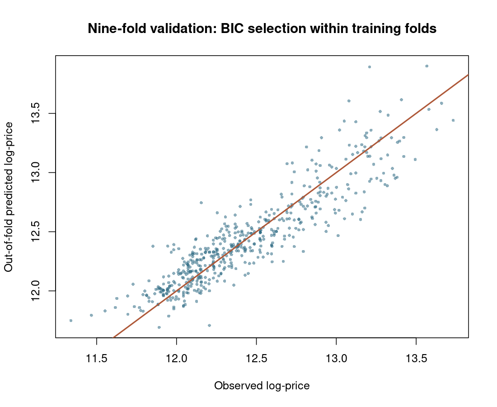
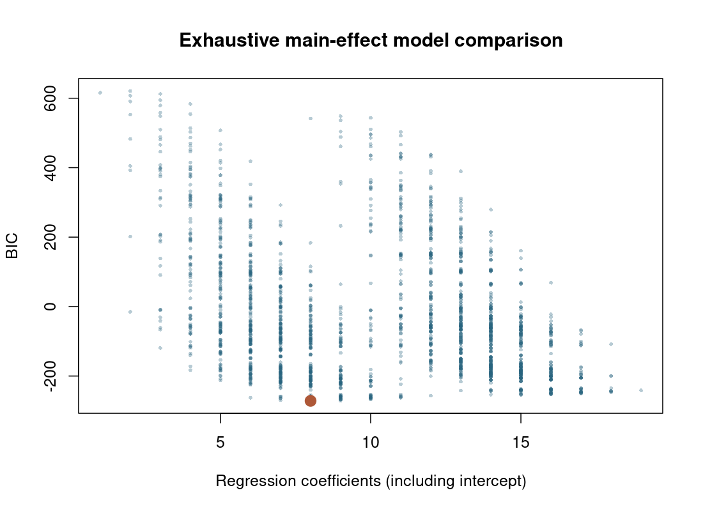
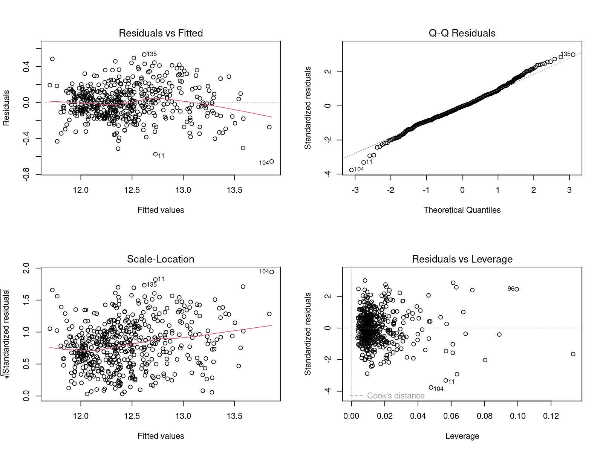
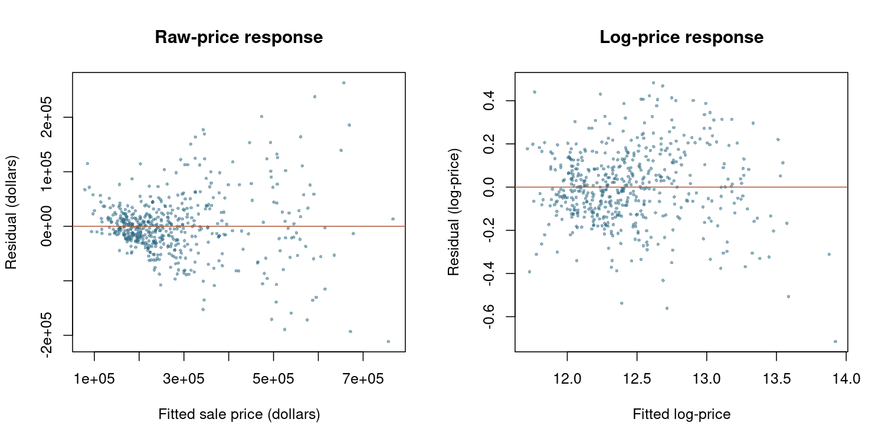

# Real Estate Regression Analysis

Multiple linear regression analysis of residential sale prices using response
transformation, categorical predictors, exhaustive model selection, cross validation,
and influence diagnostics.

## Project Overview

This project analyzes 522 real estate sales with 11 candidate explanatory variables.
The response is the natural logarithm of sale price. The analysis examines the
relationship of price to house size, amenities, construction year and quality,
architectural style, lot size, and highway adjacency.

Construction quality and architectural style are modeled as categorical predictors.
Architectural style codes with fewer than five training observations are pooled
into an Other category. This practical sparsity assumption is evaluated alongside
a model selection procedure that excludes style entirely.

## Methods

The analysis includes:

- multiple linear regression with log-transformed sale price
- exploratory Box-Cox response transformation diagnostics
- exhaustive comparison of all 2,048 main effect subsets
- AIC, BIC, Mallows' Cp, adjusted R², and PRESS
- nine-fold cross validation with preprocessing and BIC selection repeated on training data
- training residual smearing for dollar scale predictions
- exploratory hierarchical interaction modeling
- residual, leverage, DFFITS, Cook's distance, and DFBETAS diagnostics
- coefficient sensitivity to removal of flagged observations

The analysis uses base R. Categorical predictors enter or leave as complete terms.
BIC is the primary selection criterion; other criteria provide comparisons.
Log-price is a fixed response specification rather than a transformation tuned
using the validation folds. The full data Box-Cox profile is exploratory.

## Results

The BIC-selected main effect model retained:

| Predictor | Interpretation |
|---|---|
| X1 | Finished area |
| X3 | Bathrooms |
| X5 | Garage capacity |
| X7 | Year built |
| X8 | Construction quality, categorical |
| X10 | Lot size |

The selected specification is:

```r
lnY ~ X1 + X3 + X5 + X7 + X8 + X10
```

The fitted regression equation is:

$$
\begin{aligned}
\widehat{\log(\text{Sale Price})}
={}&3.984894
+0.000265560(\text{Finished Area})\\
&+0.044353(\text{Bathrooms})
+0.042334(\text{Garage Capacity})\\
&+0.00396838(\text{Year Built})
+0.00000495988(\text{Lot Size})\\
&-0.287522\,I(\text{Medium Quality})
-0.392216\,I(\text{Low Quality}).
\end{aligned}
$$

High quality is the reference category. Each indicator equals 1 when the
house belongs to that quality category and 0 otherwise. Finished area and
lot size are measured in square feet, and garage capacity is measured in
cars. The logarithm is the natural logarithm.

This equation predicts log-price. Dollar predictions in the cross-validation
analysis also apply a smearing adjustment estimated from training residuals.

It has six explanatory terms and eight regression coefficients including the
intercept, because construction quality contributes two indicator coefficients.

| In-sample measure | Value |
|---|---:|
| R² | 0.8320 |
| Adjusted R² | 0.8297 |
| Residual standard error, log-price | 0.1781 |
| AIC | -309.84 |
| BIC | -271.52 |

Architectural style was omitted by BIC on the full dataset and in every validation
fold. The procedures with and without style therefore produced identical
out-of-fold predictions here. The other selected terms varied across folds;
the full data formula should not be interpreted as uniquely established.

## Cross Validation

Each observation is predicted once from a model trained on the other eight folds.
Style grouping and exhaustive BIC selection are repeated using training data only.
The folds contain 58 observations each and are balanced across style groups.
The random seed is fixed in the script.

| Procedure | Log RMSE | Log MAE | Dollar RMSE | Dollar MAE |
|---|---:|---:|---:|---:|
| BIC selected | 0.1816 | 0.1389 | $68,704 | $42,861 |
| BIC without style | 0.1816 | 0.1389 | $68,704 | $42,861 |
| Full model | 0.1773 | 0.1365 | $68,298 | $42,134 |
| Intercept baseline | 0.4318 | 0.3533 | $137,986 | $105,598 |

The full model achieved slightly lower prediction errors than the BIC procedure.
BIC favors a more parsimonious specification; it is not the prediction error
winner in this comparison. All regression procedures improved substantially on
the intercept-only baseline.

Dollar predictions use a smearing multiplier calculated from training residuals.
A single multiplier assumes a common residual distribution and may be imperfect
under heteroscedasticity. These are internal cross validation estimates from one
split, not an independent external test or evidence of contemporary market performance.



## Model Selection



BIC, AIC, and PRESS can favor different model sizes. The script exports every
candidate's results, including the number of regression coefficients, so model
complexity accounts for categorical indicator variables. PRESS scores are
model specific leave-one-out calculations on the complete dataset, not independent
validation of the entire selection procedure.

## Regression Diagnostics



The selected model flagged 45 observations under the
DFFITS screening rule and 110 under at least one DFBETAS
screening rule. These are investigation thresholds, not deletion instructions or
significance tests. All 522 observations remain in the main analysis.

The sensitivity analysis refits the selected formula after removing DFFITS-flagged
cases and exports coefficient changes relative to the full data standard errors.
Some coefficients change appreciably, so influential cases cannot simply be
described as having negligible effects. Residual patterns and coefficient
sensitivity remain limitations of the fitted specification. Standard errors and
p-values from the selected model are exploratory and do not account for selection.

## Response Transformation and Interactions



The script compares raw-price and log-price residuals and exports an exploratory
Box-Cox profile. Its maximum occurs near lambda = -0.17; lambda = 0
(the log transform) lies slightly outside the approximate 95% profile interval.
The logarithm is retained as a simple, prespecified response scale, not claimed
to be the likelihood optimal transformation. Log transformation does not
guarantee constant variance or normal errors.

A separate backward AIC search considers pairwise interactions while retaining
all parent main effects. Its results are exploratory and were not assessed by the
primary cross validation procedure. They do not replace the selected main effect
model or supply validated performance claims.

## Data Source

Kutner, M. H., Nachtsheim, C. J., and Neter, J. (2004).
*Applied Linear Regression Models*, 4th edition. Data Set C.7, Real Estate Sales.

See [data/README.md](data/README.md) for variable definitions and input provenance.
The source dataset is not included in this public repository. To reproduce the
analysis, obtain Data Set C.7 from the cited textbook source and place a CSV
with the documented column names at `data/real_estate_sales.csv`.

## Reproducibility

From the project root in R or RStudio:

```r
source("analysis/regression_analysis.R")
```

Or from a terminal:

```bash
Rscript analysis/regression_analysis.R
```

The script regenerates all figures and results. No additional R packages are
required. The analysis was executed successfully in R 4.3.3. An independent
NumPy/SciPy calculation verified all 2,048 candidate residual sums of squares
within 3e-13. The validation outputs were checked for one prediction per case
per procedure and complete coverage of all observations. Runtime information
is recorded in `results/analysis_summary.txt`.

## Project History

This repository revisits a collaborative project originally completed by Barrett
McDonald and Cailey Cantrell for a graduate Statistical Methods II course at the
University of South Florida in Spring 2020.

The analysis presented here was reconstructed from the source data and revised
for methodological accuracy, reproducibility, and portfolio presentation rather
than copied directly from the original course report.
